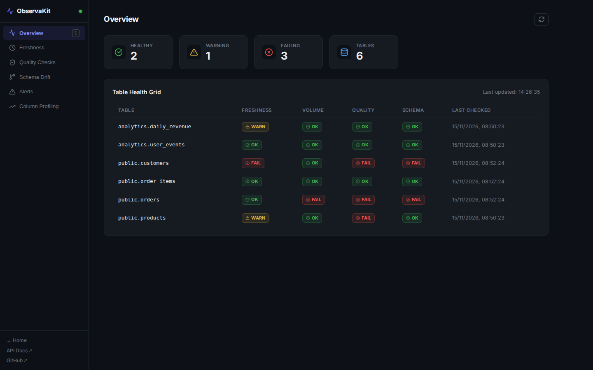
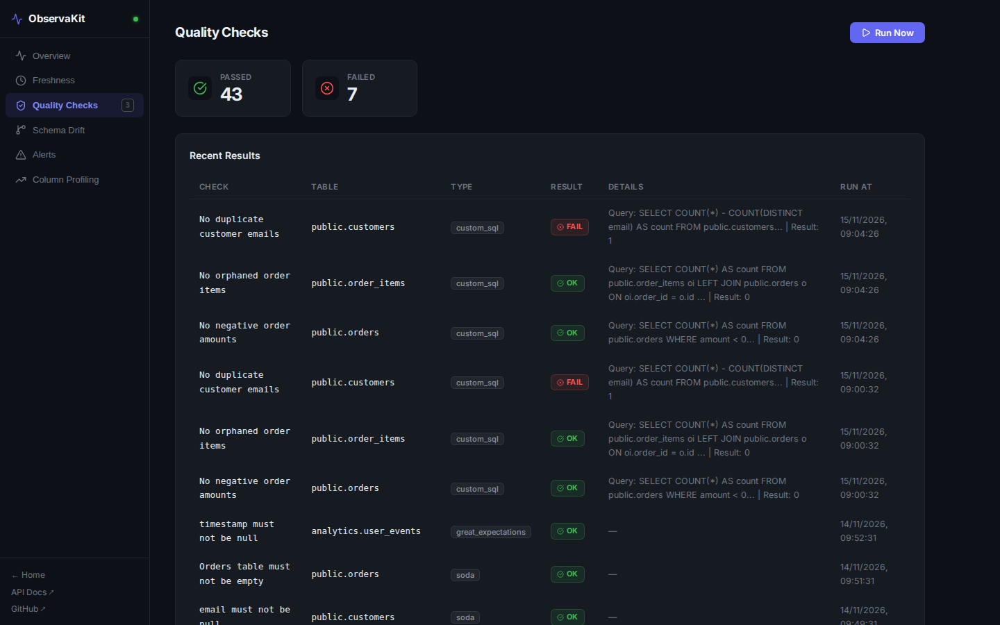
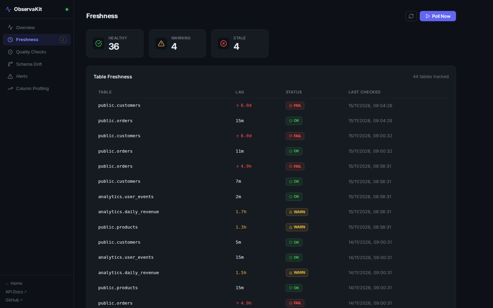
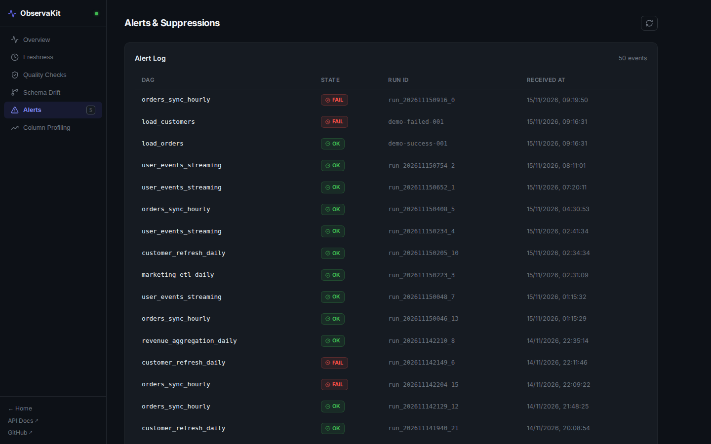
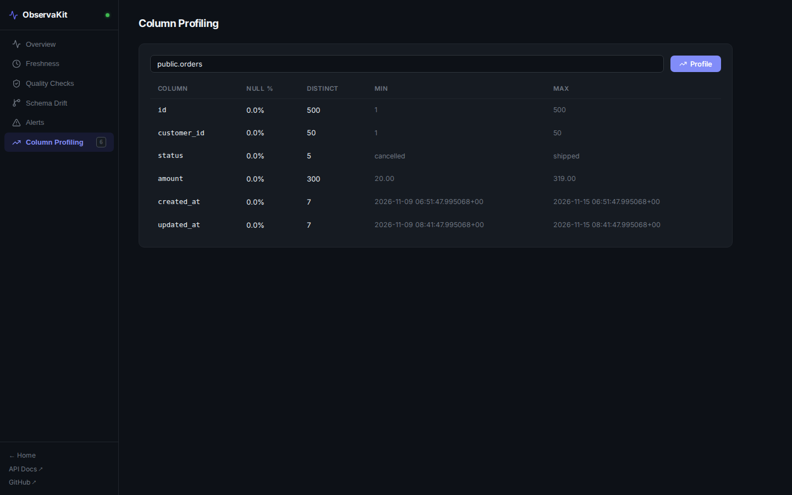
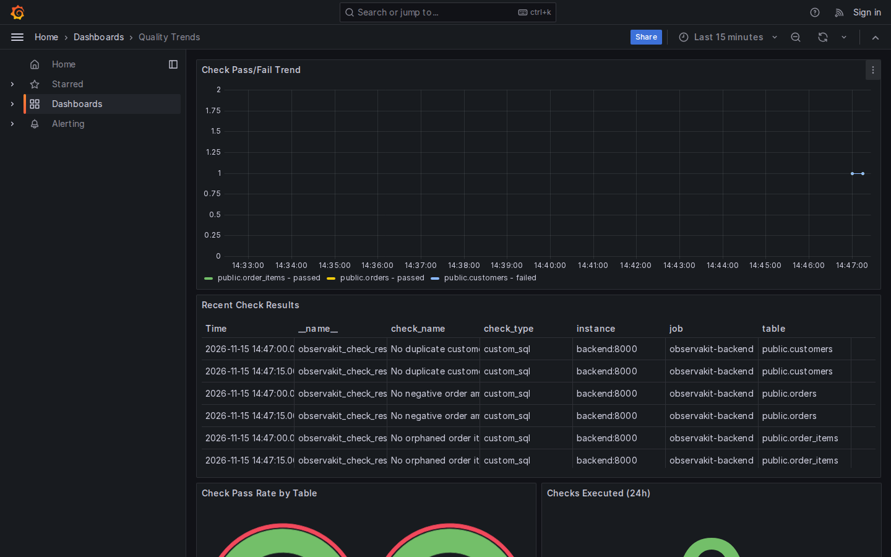
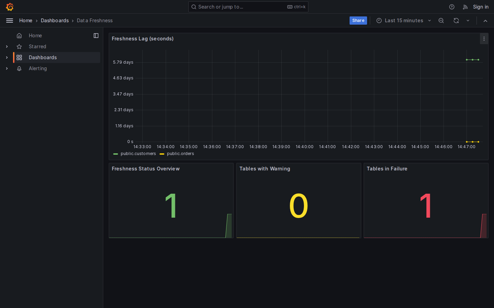
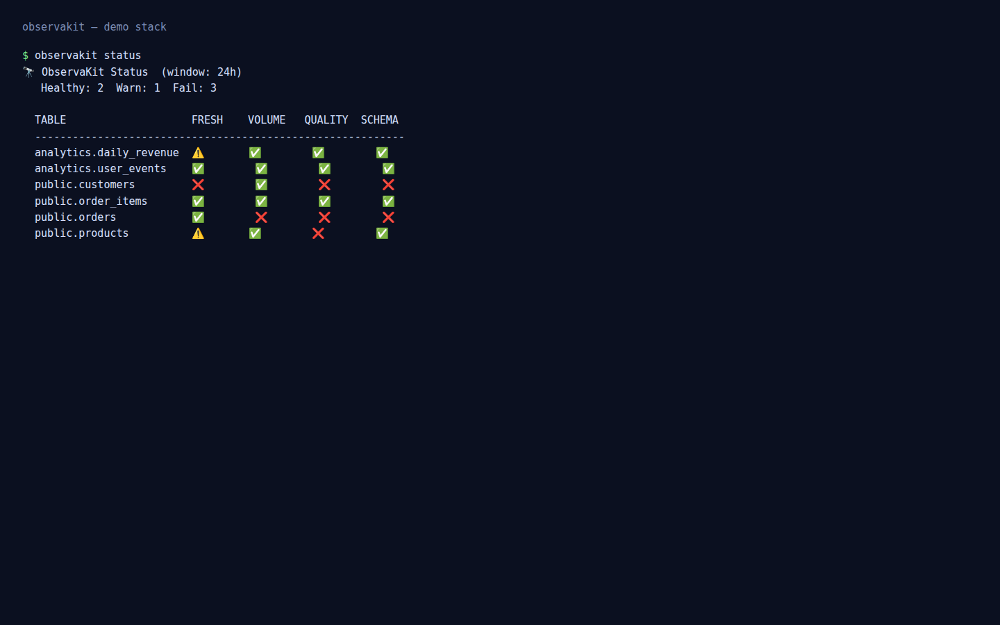
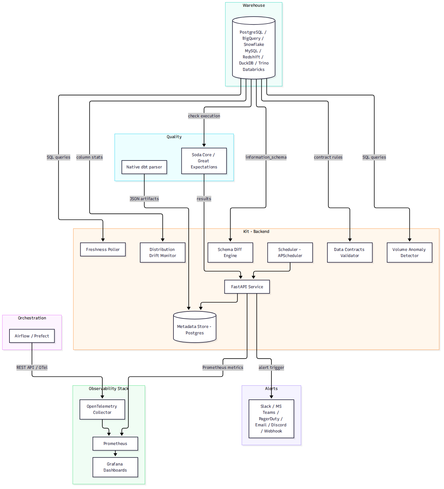

<p align="center">
  <a href="https://www.willowvibe.com">
    
  </a>
</p>

<h1 align="center">🔭 ObservaKit</h1>
<p align="center"><strong>Self-hosted data observability for small data teams — free forever.</strong></p>

<p align="center">
  
  
  
  
  
  
  
</p>

<p align="center">
  <a href="docs/getting-started.md">Getting Started</a> •
  <a href="docs/real-world-use-cases.md">Use Cases</a> •
  <a href="docs/adding_checks.md">Adding Checks</a> •
  <a href="docs/alerting_setup.md">Alert Setup</a> •
  <a href="docs/faq.md">FAQ</a> •
  <a href="docs/troubleshooting.md">Troubleshooting</a>
</p>

---



> **ObservaKit** gives 1–5 person data teams the same observability pillars that commercial platforms typically charge five figures annually for — running entirely on your own infrastructure in under 10 minutes.

## Who this is for

- **1–5 person data teams** that cannot justify a six-figure observability contract.
- **Analytics engineers at seed and Series A companies** who are the de facto on-call for the warehouse.
- **Consultants running data migrations** who need freshness, volume, and schema parity between source and destination.
- **Platform teams** that want Prometheus and Grafana integration without another SaaS vendor.

## One-command demo (no warehouse needed)

```bash
git clone https://github.com/willowvibe/ObservaKit.git
cd ObservaKit
make demo-up
```

This starts the backend, metadata store, a seeded demo warehouse, Prometheus, and Grafana. After about a minute, open:

| Surface | URL |
|---|---|
| Dashboard | http://localhost:8000/ui |
| API docs | http://localhost:8000/docs |
| Grafana | http://localhost:3001 |
| Prometheus | http://localhost:9090 |

The demo warehouse contains 500 orders, 50 customers, and 1,200 order items. `customers` is deliberately stale and has a duplicate email so freshness and quality each have a real failure to show. The seeder runs real freshness, volume, schema, and custom SQL checks against that warehouse; the seven-day history around them is generated sample data.

> The demo API key is `observakit-demo-key`. It is baked into the demo UI and is only for local use. Do not expose the demo stack to the internet.

## Why ObservaKit?

| Pain | Without ObservaKit | With ObservaKit |
|------|--------------------|-----------------|
| Pipeline breaks silently at 3 AM | Dashboard is stale, stakeholders notice first | Freshness alert fires within 15 minutes |
| A column gets renamed in production | Downstream models fail with cryptic errors | Schema drift alert fires at next snapshot |
| Volume drops 70% after a bad deploy | Nobody notices until the weekly meeting | Z-score anomaly fires immediately |
| A vendor changes their API response format | Null % climbs for weeks undetected | Distribution drift alert fires |
| New engineer changes `status` values | Analytics break but tests pass | Data contract violation alert fires |
| "Who broke the orders table?" | Hours of detective work in Slack | Lineage-aware alert names the upstream table |

## The 7 Observability Pillars

| # | Pillar | What It Catches |
|---|--------|-----------------|
| 1 | **🕐 Freshness** | Stale tables — `max(updated_at)` vs SLA threshold |
| 2 | **📊 Volume** | Row-count anomalies — Z-score against 7-day rolling avg |
| 3 | **✅ Quality Checks** | Nulls, duplicates, value ranges, FK violations (Soda Core / GX / custom SQL) |
| 4 | **🔀 Schema Drift** | Added/removed columns, type changes |
| 5 | **🚀 Pipeline Health** | Airflow/Prefect success rates, SLA misses, task durations |
| 6 | **📈 Distribution Drift** | Column value distribution shifts — the silent killer |
| 7 | **📋 Data Contracts** | Schema + business rule violations against producer-defined contracts |

> **Plus:** FinOps Tracker (Snowflake credits / BigQuery bytes), Native dbt Integration, Column Profiling, Cross-table Consistency Checks, and Lineage-aware Alerts.

## Supported Warehouses

| Warehouse | Status |
|-----------|--------|
| PostgreSQL | ✅ Supported |
| BigQuery | ✅ Supported |
| Snowflake | ✅ Supported |
| MySQL / MariaDB | ✅ Supported |
| Amazon Redshift | ✅ Supported |
| DuckDB | ✅ Supported |
| Databricks | ✅ Supported |
| Trino / Presto | ✅ Supported |

## Supported Alert Channels

| Channel | Status |
|---------|--------|
| Slack | ✅ Supported |
| Email (SMTP) | ✅ Supported |
| Discord | ✅ Supported |
| Generic Webhook | ✅ Supported (PagerDuty, Opsgenie, n8n, etc.) |
| Microsoft Teams | ✅ Supported |
| PagerDuty native | ✅ Supported |

## Screenshots

| Dashboard | Quality checks |
|---|---|
|  |  |

| Freshness | Alerts |
|---|---|
|  |  |

| Column profiling | Grafana quality trends |
|---|---|
|  |  |

| Grafana freshness | CLI |
|---|---|
|  |  |

All screenshots are captured from the demo stack by `scripts/capture_screenshots.py`.

## Quickstart with your own warehouse

**Prerequisites:** Docker + Docker Compose v2, Python 3.10+, and a supported SQL warehouse.

```bash
git clone https://github.com/willowvibe/ObservaKit.git
cd ObservaKit
cp .env.example .env
# Set WAREHOUSE_* and OBSERVAKIT_API_KEY in .env
docker compose up -d
```

Open http://localhost:8000/ui. If you use the legacy `docker-compose` binary, every Make target detects it automatically.

> The Docker build embeds `OBSERVAKIT_API_KEY` in the dashboard bundle so the UI can call protected endpoints. Use a dedicated key and keep ObservaKit on a trusted network.

> **Full step-by-step walkthrough** → [docs/getting-started.md](docs/getting-started.md)

## Configuration

All settings live in `config/kit.yml`. Environment variables are expanded with `${VAR:-default}` syntax.

```yaml
warehouse:
  type: postgres   # postgres | bigquery | snowflake | mysql | redshift

freshness:
  enabled: true
  tables:
    - table: public.orders
      timestamp_column: updated_at
      warn_after: 1h
      fail_after: 2h

distribution:
  enabled: true
  tables:
    - table: public.orders
      columns:
        - name: status
          type: categorical     # tracks top-20 value shares over time
        - name: amount
          type: numeric         # tracks histogram + mean over time

contracts:
  enabled: true
  contracts_dir: config/contracts/  # one YAML file per contract
```

See the [annotated kit.yml](config/kit.yml) for all options.

## Data Contracts

Define a YAML contract for any table and ObservaKit will validate it on every run:

```yaml
# config/contracts/orders_v1.yml
contract:
  id: orders_v1
  version: "1.0.0"
  table: public.orders
  columns:
    - name: status
      nullable: false
      allowed_values: [pending, confirmed, shipped, delivered, cancelled]
    - name: amount
      nullable: false
      min: 0
  rules:
    - name: "No future-dated orders"
      sql: "SELECT COUNT(*) FROM public.orders WHERE created_at > NOW()"
      assert: "result == 0"
```

```bash
curl -X POST http://localhost:8000/contracts/validate \
  -H "X-API-Key: $OBSERVAKIT_API_KEY"
```

> Full guide → [docs/data-contracts.md](docs/data-contracts.md)

## Distribution Drift

The silent killer in production. Your `status` column still exists, your row count is fine — but 80% of orders are now `cancelled` instead of the usual 5%:

```yaml
distribution:
  enabled: true
  tables:
    - table: public.orders
      drift_threshold: 0.10        # alert if any value's share shifts >10%
      null_drift_threshold: 0.05   # alert if null % shifts >5%
      columns:
        - name: status
          type: categorical
```

ObservaKit snapshots distributions on a schedule and compares them. A Slack alert fires before your stakeholders notice.

## CLI

```bash
pip install -e .

observakit status             # full health summary (supports --output json)
observakit check              # run quality checks (supports --output json)
observakit profile            # profile all configured tables
observakit suppress orders 4h # mute alerts for 4 hours (planned maintenance)
observakit validate-config    # dry-run parse kit.yml (no warehouse needed)
observakit diff               # compare schema snapshot vs saved version
observakit init               # interactive setup wizard
observakit test-alert         # fire a manual test notification
```

## Architecture



The Mermaid source stays in [docs/architecture.md](docs/architecture.md).

## Project Structure

```
ObservaKit/
├── backend/
│   ├── main.py                  ← FastAPI app + /healthz + /status
│   ├── models.py                ← SQLAlchemy models (12 tables)
│   ├── scheduler.py             ← APScheduler (standalone mode)
│   └── routers/
│       ├── checks.py            ← Quality checks + volume + consistency
│       ├── freshness.py         ← Freshness polling
│       ├── schema_diff.py       ← Schema drift detection
│       ├── distribution.py      ← Distribution drift (NEW)
│       ├── contracts.py         ← Data contracts (NEW)
│       ├── finops.py            ← Cost tracking
│       ├── profiling.py         ← Column profiling
│       ├── suppressions.py      ← Alert suppression windows
│       └── webhooks.py          ← Incoming webhooks
├── connectors/
│   ├── postgres.py              ← PostgreSQL
│   ├── bigquery.py              ← BigQuery
│   ├── snowflake.py             ← Snowflake
│   ├── mysql.py                 ← MySQL / MariaDB
│   ├── redshift.py              ← Amazon Redshift
│   ├── duckdb.py                ← DuckDB (NEW)
│   ├── databricks.py            ← Databricks (NEW)
│   └── trino.py                 ← Trino (NEW)
├── alerts/
│   ├── slack.py                 ← Slack (Block Kit + Retries)
│   ├── email.py                 ← SMTP email
│   ├── discord.py               ← Discord webhooks
│   ├── teams.py                 ← MS Teams (NEW)
│   ├── pagerduty.py             ← PagerDuty Native (NEW)
│   └── webhook.py               ← Generic outgoing webhook
├── config/
│   ├── kit.yml                  ← Master config (all pillars)
│   ├── contracts/               ← Data contract YAML files (NEW)
│   │   └── example_orders.yml
│   └── warehouses/              ← Per-warehouse connection configs
├── checks/
│   ├── templates/               ← Soda Core + Great Expectations templates
│   └── examples/                ← Example checks for orders, self-checks
├── dbt_integration/             ← Native dbt artifact parser
├── landing-page/                ← Vite/React embedded dashboard
├── cli/                         ← observakit CLI
├── tests/                       ← Pytest suite
├── docs/                        ← Full documentation
├── grafana/                     ← Grafana dashboard provisioning
├── prometheus/                  ← Prometheus config
├── otel/                        ← OpenTelemetry collector config
├── docker-compose.yml           ← Full stack
├── docker-compose.lite.yml      ← Lite mode (backend + postgres only)
└── Makefile                     ← make up / down / test / demo
```

## Comparison with Alternatives

| Feature | ObservaKit | Monte Carlo | Metaplane | Great Expectations |
|---------|-----------|-------------|-----------|-------------------|
| **Price** | Free / self-hosted | Commercial SaaS; typically five figures annually | Commercial SaaS; typically five figures annually | Free (OSS) |
| **Setup time** | < 10 min | Days (sales cycle) | Days | Hours–Days |
| **Self-hosted** | ✅ | ❌ SaaS only | ❌ SaaS only | ✅ |
| **Freshness monitoring** | ✅ | ✅ | ✅ | ❌ |
| **Volume anomaly detection** | ✅ | ✅ | ✅ | ❌ |
| **Distribution drift** | ✅ | ✅ | ✅ | Partial |
| **Schema drift** | ✅ | ✅ | ✅ | ❌ |
| **Data contracts** | ✅ | ✅ (enterprise) | ❌ | ❌ |
| **Native dbt integration** | ✅ (no packages) | ✅ | ✅ | Partial |
| **Pipeline health (Airflow/Prefect)** | ✅ | ✅ | Partial | ❌ |
| **FinOps tracking** | ✅ | ❌ | ❌ | ❌ |
| **MySQL / Redshift support** | ✅ | ✅ | Partial | ✅ |
| **Discord alerts** | ✅ | ❌ | ❌ | ❌ |
| **Vendor lock-in** | ❌ None | 🔒 High | 🔒 High | ❌ None |

## Illustrative Use Cases

- **Data migration audits** — Run ObservaKit against source and destination simultaneously to guarantee zero schema drift and 100% volume parity during cloud migrations.
- **dbt project health** — Parse `run_results.json` natively; no Elementary package or dbt Cloud required. Track model success rates and test failures in one place.
- **Multi-team data contracts** — Each producing team owns a contract YAML. ObservaKit validates it on every pipeline run and alerts consumers before they're broken.
- **Cost governance** — Track Snowflake credit burn and BigQuery bytes billed per pipeline. Alert when a single query scans more than a configured threshold.
- **Seed-stage startups** — Get enterprise-grade data observability on a startup budget. Replace ad-hoc Slack messages with structured, routed alerts.

Full scenarios → [docs/real-world-use-cases.md](docs/real-world-use-cases.md)

## Makefile Commands

```bash
make up           # Start full stack (Prometheus + Grafana)
make up-lite      # Start lite mode (backend + postgres only)
make down         # Stop all services
make build        # Rebuild backend Docker image
make test         # Run pytest suite
make test-cov     # Run tests with coverage report
make lint         # Ruff linting
make format       # Auto-format with ruff
make migrate      # Run Alembic migrations
make demo-up      # Start the seeded demo stack (backend, warehouse, Prometheus, Grafana)
make demo-down    # Stop the demo stack and remove volumes
make demo-reset   # Recreate and reseed the demo stack
make test-smoke   # Docker-free smoke test
make logs         # Follow backend logs
make dev          # Run in dev mode (hot reload)
make ui-build     # Build React dashboard
```

## A worked FinOps example (illustrative)

> This is an arithmetic example, not a client result.

A five-person data team spending **$8,000/month** on a warehouse runs 40 scheduled pipelines. If one pipeline scans a 30-day partition instead of a 1-day partition every night, the extra scan can add **10–20%** to the monthly bill. ObservaKit's FinOps tracker records per-pipeline scan volume and alerts when a query exceeds its configured threshold. At 10%, that is **$800/month** — visible before the invoice arrives.

The numbers are assumptions for illustration. Your warehouse, pricing model, and query mix determine the real figure.

## How I'd adapt this for your business

I build self-hosted data observability and pipeline reliability systems for small data teams. If you have a warehouse that silently breaks, a migration that needs parity checks, or a dbt project with no test visibility, I can adapt ObservaKit to your stack and leave your team with runbooks, alert routing, and a working demo. [Get in touch](https://www.willowvibe.com).

## Documentation

| Guide | Description |
|-------|-------------|
| [Getting Started](docs/getting-started.md) | Step-by-step first 15 minutes |
| [Adding Checks](docs/adding_checks.md) | Write Soda, GX, and custom SQL checks |
| [Data Contracts](docs/data-contracts.md) | Define and enforce data contracts |
| [Alert Setup](docs/alerting_setup.md) | Configure Slack, Email, Discord, Webhooks |
| [Architecture](docs/architecture.md) | System design with diagrams |
| [Illustrative Use Cases](docs/real-world-use-cases.md) | Illustrative ways teams use ObservaKit |
| [FAQ](docs/faq.md) | Frequently asked questions |
| [Troubleshooting](docs/troubleshooting.md) | Common issues and fixes |

> 📹 **2-minute walkthrough** — see [docs/demo-script.md](docs/demo-script.md) for the shot list and narration. The rendered MP4 is attached to the [v1.0.0 release](https://github.com/willowvibe/ObservaKit/releases/tag/v1.0.0).

## Contributing

Contributions welcome! See [CONTRIBUTING.md](CONTRIBUTING.md) for guidelines.

**Good first issues:**
- Add a Grafana dashboard for a new use case
- Write a quality check template for a common schema pattern
- Improve documentation or add a tutorial
- Add column-level lineage tracking
- Improve the CLI experience with autocomplete

## License

MIT — free to use, modify, and distribute.

---

**Built by [WillowVibe DataSynapse](https://www.willowvibe.com)** — AI-first data enablement for modern teams.
